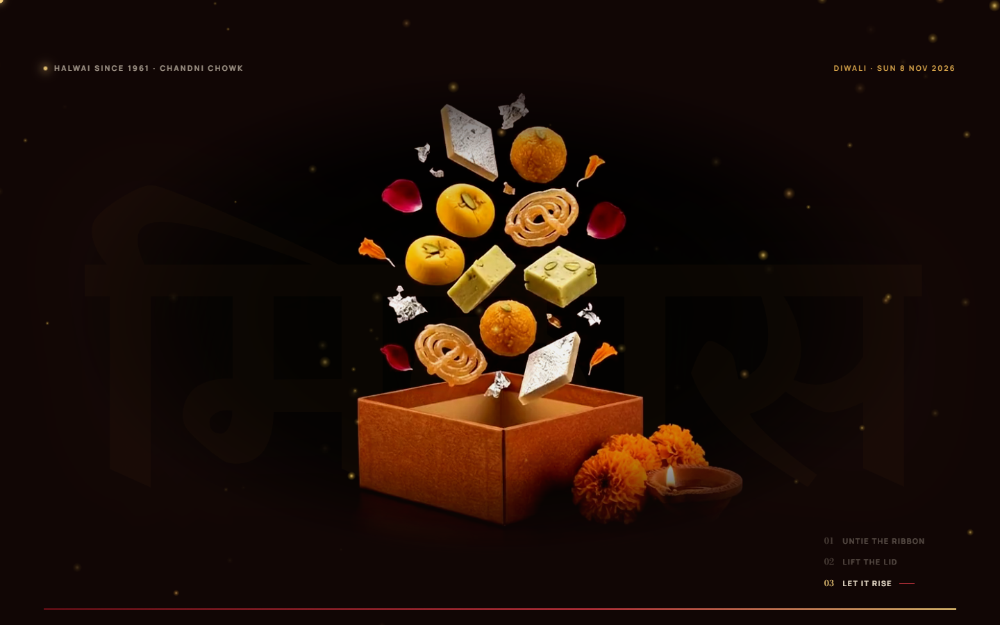

<div align="center">




**A scroll-scrubbed Diwali mithai shop — open something *sweet* this Diwali.**

[](docs/media/mithaas-promo.mp4)
[](#run-it)
[](https://gsap.com)
[](https://github.com/darkroomengineering/lenis)
[](https://github.com/showheyohtaki/motion-prompt)

</div>

---

## The moment

A gold-foil gift box sits in the dark under a giant **मिठास**. You scroll and the film beneath the page **scrubs frame by frame**: the ribbon unties, the lid lifts out of the top of the frame, and the sweets rise out of the box. Scroll back up and it puts itself away.

Then the counter begins. Six sweets, one screen of scroll each. Every one starts **whole and centred** and breaks apart in slow motion — kaju katli fans out under silver varq, the laddoo bursts into boondi pearls, the soan papdi unravels into silk threads — and scrolling up rebuilds them.



## What is actually in here

| | |
|---|---|
| **Scrub engine** | Each clip is fetched **whole as a blob** and played from an object URL, so every seek is local. One GSAP ticker eases each clip's time toward `progress × (duration − 0.05)` and writes `currentTime` only when it moved > 10 ms and the video isn't seeking. Only the on-screen clip is active. |
| **All-keyframe encodes** | Every 2nd frame is a keyframe (`keyint=2:min-keyint=1:scenecut=0:bframes=0`), so a seek is a single decode — that's why the scrub never shows a black frame. |
| **Seamless blending** | Films sit in a layer with `mix-blend-mode: lighten`. The page ink is a touch brighter than the film, so the film's background *disappears* and the giant Devanagari word behind shows through everywhere except where the sweets are. |
| **The box builder** | A CSS gold-foil box with a 3×3 ivory tray. Tap a sweet and it flies in an arc into the next compartment and lands with an elastic bounce. Seal it and the lid drops with a red ribbon cross; the CTA becomes a pre-filled WhatsApp order. |
| **Liquid glass** | In the promo film the glass is real: the backdrop is re-drawn blurred and magnified, clipped to a rounded shape, tinted, given an inner glow, a refractive rim and a specular sheen that travels. |
| **Phones** | Below 1000 px the box film goes 190vw and centred, the counter stacks film over copy, the nav becomes a full-screen menu, and the 720w `-m.mp4` clips are served instead. |
| **Reduced motion** | No smooth scroll, no grain, no dust, no animation durations. Every reveal is already in its final state. |

## Run it

```bash
npx serve .            # or: node scripts/serve.js 8123
```

Any static host works — Netlify, S3, GitHub Pages, nginx. Open it through a server, not `file://`: the scroll clips are fetched and played from blob URLs.

**Stack:** static HTML/CSS/JS · no build step · no framework · GSAP 3.12.5 + ScrollTrigger (cdnjs) · Lenis 1.1.13 (unpkg) · Bodoni Moda / Manrope / Yatra One (Google Fonts).

## What is in the box

```
index.html                the whole page, one document
css/style.css             every token and every rule
js/main.js                one classic script: data, scrub engine, sections
media/                    the built assets (64 MB) — ship this
  hero/<name>.mp4         1280w scroll-scrub clip
  hero/<name>-m.mp4        720w same clip for phones
  v/<name>.mp4             loop films + .jpg posters
  img/thumb-<name>.webp   480² round thumbnails
  img/share.webp          social share card
scripts/process.sh        ffmpeg pipeline: assets/ → media/
scripts/render-video.js   frame-accurate 1080p render of the promo film
scripts/serve.js          tiny local static server
video/promo.html          the promo film: a Canvas 2D timeline
docs/banner.svg           the animated header above
docs/media/               the film, the GIF, the poster
docs/ASSET-PROMPTS.md     every prompt the assets were generated from
assets/                   the raw AI downloads — NOT shipped
```

## Change the shop

Every word on the page is HTML — **no text is baked into any image or film**, so the shop can be renamed without regenerating a single asset.

| What | Where |
|---|---|
| Brand, headlines, section copy, address | `index.html` |
| WhatsApp number, Diwali date, box price, pieces per box | `SITE` in `js/main.js` |
| The six sweets, prices, descriptions, ingredients | `SWEETS` in `js/main.js` |
| The four price-list tabs and every row | `MENU` in `js/main.js` |
| Colours, gradients, type scale | the tokens at the top of `css/style.css` |
| Your own renders | drop them in `assets/`, run `sh scripts/process.sh` |

```js
var SITE = {
  brand: 'Mithaas & Co.',
  whatsapp: '919811061961',            // digits only, country code first
  diwali: '2026-11-08T18:30:00+05:30', // Lakshmi Puja, IST. After this date the page
                                       // reads "Shubh Deepavali" instead of a countdown
  boxPrice: 150,                       // the empty box, in ₹
  slots: 9                             // compartments in the 3×3 tray
};
```

One sweet looks like this — copy the block and the counter, the index, the picker and the price list all follow:

```js
{
  id: 'kaju',                       // must match media/hero/kaju.mp4 + media/img/thumb-kaju.webp
  en: 'Kaju Katli',
  hi: 'काजू कतली',                   // Yatra One
  acc: '#e8dcc4',                   // the Hindi name's colour, the glow behind the film
  kg: 1180, pc: 59,                 // ₹ per kilo, ₹ per piece
  desc: 'Cashews ground to a whisper, set into diamonds and laid with real silver varq.',
  made: 'Cashew, cane sugar, silver leaf',
  keeps: '12 days'
}
```

Adding a seventh sweet means one more scroll film in `media/hero/` and one more screen of scroll — the pins are sized from `SWEETS.length`, so it just works.

## The asset pipeline

`scripts/process.sh` builds all of `media/` from the raw renders in `assets/`:

- **7 scroll clips** at 1280w (CRF 25) and 720w (CRF 27), all-keyframe, no audio, faststart
- **15 loops** at 1280w (CRF 26) with first-frame posters
- **480² thumbnails** cut from each film's first frame
- **a share card** from the box's last frame
- one `delogo` box removes the generator's sparkle mark, scaled to whatever the source resolution is

**The rule that makes the films melt into the page:** every render shares the same deep oxblood-black background. Change the ink or the renders and you change that relationship — `--ink` is the first token in `css/style.css`.

## Editing notes

- **GSAP owns `transform`.** Anything GSAP moves is centred with `xPercent` / `yPercent` set through `gsap.set` — never a CSS `transform` on the same element. The box lid's resting offset, the halwai ring, the film centring and the cursor all work this way.
- **`background-clip: text` does not paint transformed children**, so the gold gradient words are never split into animated letters.
- **Stacking contexts break `mix-blend-mode`.** Do not add `z-index`, `opacity`, `filter` or `will-change` to an ancestor of `.hero__film` / `.sweet__film` — the blend isolates and the film's rectangle becomes visible again. A filter on the `<video>` child is safe.
- **Pinned sections are measured from the top**, so scroll memory is cleared (`ScrollTrigger.clearScrollMemory('manual')`) and a reload always starts at the top.

## The film

<a href="docs/media/mithaas-promo.mp4"></a>

*Three cuts ship with it: `mithaas-promo.mp4` (1920×1080), `mithaas-promo-square.mp4` (1080×1080, the LinkedIn cut) and `mithaas-promo-vertical.mp4` (1080×1920, Reels).*

Rendered frame-accurately from `video/promo.html` by `scripts/render-video.js`:

```bash
node scripts/serve.js 8123        # in one terminal
node scripts/render-video.js 25   # 465 frames at 1920×1080 into video/frames/
ffmpeg -framerate 25 -i video/frames/%04d.jpg -c:v libx264 -crf 20 \
  -pix_fmt yuv420p -movflags +faststart docs/media/mithaas-promo.mp4
```

Liquid moves ported from **[Motion Prompt](https://github.com/showheyohtaki/motion-prompt)** by Shohei Ohtaki (MIT) — the attribution line is kept at the top of `video/promo.html`:

- **#019 Liquid transition** — paint-like liquid drips down from the top and fills the frame, becoming the next scene. Used at every scene change.
- **#013 Liquid motion** — the blob vocabulary the glass edges borrow.
- Kit helpers (`clamp`, `lerp`, `P`, `eIOs`, seeded `rand`) carried over from the `motion` pack.

## Credits

Type: **Bodoni Moda** (display), **Manrope** (body), **Yatra One** (Devanagari) via Google Fonts.
Motion: **GSAP 3.12.5** + **ScrollTrigger** (cdnjs), **Lenis 1.1.13** (unpkg).
Promo film: **Motion Prompt** #019 / #013 by Shohei Ohtaki, MIT.
All films and stills are AI-generated from the prompts in [docs/ASSET-PROMPTS.md](docs/ASSET-PROMPTS.md), and are wordless by design.

---

<div align="center">
<sub>Built as a template for a halwai who has been frying in pure desi ghee since 1961.</sub>
</div>
